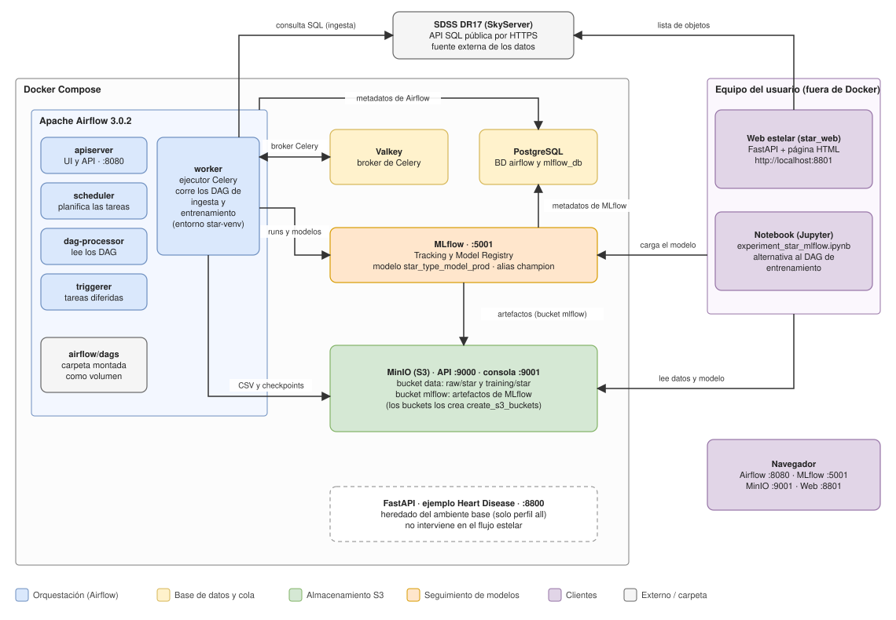
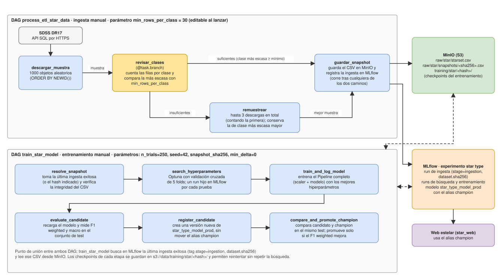

# Clasificación de objetos astronómicos (SDSS) con Airflow, MLflow y MinIO

Integrantes :

-Miguel A. Azar (a2702)

-Gonzalo L. Rigirozzi (a2712)

-Roberto M. Briend (a2608)

Status del TP:

De acuerdo a los requerimientos indicados en el README.md del trabajo practico:

*## Tarea a realizar*

*La tarea es implementar el modelo que desarrollaron en Aprendizaje de Máquina en este ambiente productivo.* **Completado**
 Para ello, pueden usar y crear los buckets y bases de datos que necesiten. Lo mínimo que deben realizar es:

*- Un DAG en Apache Airflow. Puede ser cualquier tarea que se desee realizar, como entrenar el modelo, un proceso ETL, etc.* **Completado**
*- Un experimento en MLflow de búsqueda de hiperparámetro.* **Completado**
*- Servir el modelo implementado en AMq1 en el servicio de RESTAPI.*  **Completado**
*- Documentar (comentarios y docstring en scripts, notebooks, y asegurar que la documentación de FastAPI esté de acuerdo al modelo).* **Completado**


Trabajo final de MLOps1 (CEIA, FIUBA). El proyecto clasifica objetos del catálogo
[SDSS DR17](https://skyserver.sdss.org/dr17/) en tres clases, **GALAXY**, **QSO** y **STAR**, a partir de
cinco bandas fotométricas (`u`, `g`, `r`, `i`, `z`) y cuatro colores (`u-g`, `g-r`, `r-i`, `i-z`).

Todo el ciclo corre localmente con Docker Compose:

1. **Ingesta:** un DAG de Airflow descarga una muestra aleatoria de SDSS, revisa que haya suficientes
   ejemplos de cada clase y la guarda en MinIO (un S3 local) con su hash SHA-256.
2. **Entrenamiento:** otro DAG busca hiperparámetros con Optuna, entrena un modelo de scikit-learn y lo
   registra en MLflow.
3. **Promoción:** el modelo candidato reemplaza al `champion` solo si mejora el F1 weighted en el mismo
   conjunto de test.
4. **Uso:** una web local predice la clase de un objeto con el modelo `champion` vigente.

## Arquitectura



| Servicio | Función | Dirección local |
|---|---|---|
| Apache Airflow 3.0.2 | Orquesta los DAG (ejecutor Celery) | http://localhost:8080 (`airflow` / `airflow`) |
| MLflow | Seguimiento de experimentos y registro de modelos | http://localhost:5001 |
| MinIO | Almacenamiento S3 (buckets `data` y `mlflow`) | consola http://localhost:9001 (`minio` / `minio123`), API en el puerto 9000 |
| PostgreSQL | Bases `airflow` y `mlflow_db` | puerto 5432 |
| Valkey | Broker de Celery para Airflow | sin puerto expuesto |
| Web estelar | Predicción con el modelo `champion` (corre fuera de Docker) | http://localhost:8801 |
| FastAPI Heart Disease | Ejemplo heredado del ambiente base, solo con el perfil `all` | http://localhost:8800 |

Las credenciales y los puertos son valores para desarrollo local. Pueden cambiarse en `.env`.

## Los DAG



### `process_etl_star_data` (ingesta)

Es un DAG manual. Consulta SDSS DR17 con la API SQL (une `PhotoObj` y `SpecObj`, filtra
`scienceprimary = 1`) y toma hasta 1000 objetos aleatorios con `ORDER BY NEWID()`. Sus tareas:

- `descargar_muestra`: descarga la muestra.
- `revisar_clases` (`@task.branch`): cuenta las filas de cada clase y compara la clase más escasa con el
  parámetro **`min_rows_per_class`** (30 por defecto, editable al lanzar el DAG).
- `remuestrear`: se ejecuta solo si la muestra no alcanza el mínimo. Hace hasta 3 descargas en total
  (contando la primera) y conserva la que tiene más filas en su clase más escasa. Si ninguna alcanza el
  mínimo, deja una advertencia en el log y guarda igualmente la mejor, por lo que el DAG termina en verde.
- `guardar_snapshot`: guarda el CSV y registra la ingesta en MLflow.

Resultados de cada ejecución:

- `s3://data/raw/star/starset.csv`: la muestra más reciente.
- `s3://data/raw/star/snapshots/<sha256>.csv`: una copia identificada por su hash.
- Un run en el experimento `star type` de MLflow, con los tags `stage=ingestion` y `dataset.sha256`.

Para probar el camino de remuestreo, lanza el DAG con `min_rows_per_class = 9999`.

### `train_star_model` (entrenamiento)

Es un DAG manual, con seis tareas independientes que corren en un entorno Python preinstalado en la imagen
(`star-venv`):

| Tarea | Qué hace |
|---|---|
| `resolve_snapshot` | Toma la última ingesta exitosa (o el hash indicado) y verifica el CSV |
| `search_hyperparameters` | Búsqueda con Optuna y validación cruzada de 5 folds |
| `train_and_log_model` | Entrena el Pipeline completo (scaler y modelo) |
| `evaluate_candidate` | Recarga el modelo y mide F1 weighted y macro en el conjunto de test |
| `register_candidate` | Crea una versión nueva de `star_type_model_prod`, sin mover el alias |
| `compare_and_promote_champion` | Compara candidato y `champion` en el mismo test; promueve solo si el F1 weighted mejora |

| Parámetro | Valor por defecto | Uso |
|---|---|---|
| `n_trials` | 250 | Pruebas de Optuna. Usa 2 o 5 para una prueba rápida |
| `seed` | 42 | Partición train/test y semilla de Optuna |
| `snapshot_sha256` | vacío | Vacío usa la última ingesta exitosa; también acepta un hash concreto |
| `min_delta` | 0.0 | Mejora mínima de F1 exigida para promover |

Los checkpoints de cada etapa se guardan en `s3://data/training/star/<hash>/`. Si una etapa falla, se puede
reintentar desde esa tarea sin repetir la búsqueda.

La lógica de entrenamiento está en `airflow/dags/star_training/` y también la usa la notebook
`notebooks/experiment_star_mlflow.ipynb`, que es una alternativa interactiva al DAG.

## Web estelar

La carpeta `star_web/` contiene una web local (FastAPI y una página HTML). Carga hasta 10000 objetos de
SDSS, permite elegir uno por su `objid` y llama a `POST /api/predict`, que usa el modelo
`star_type_model_prod@champion` de MLflow. Después de predecir, compara el resultado con la clase de SDSS.
La documentación interactiva de su API está en http://localhost:8801/docs.

## Inicio rápido

**Requisitos:** Docker con Docker Compose v2 (`docker compose`), al menos 4 GB de memoria para Docker (se
recomiendan 8 GB), acceso a Docker Hub, PyPI y `skyserver.sdss.org`, y Python 3.11, 3.12 o 3.13 para la web.

1. Clona el repositorio y entra en la carpeta:

   ```bash
   git clone https://github.com/rmbriend/MLOps_TP_final.git
   cd MLOps_TP_final
   ```

2. En Linux o macOS, define tu UID para que Airflow no cree carpetas como `root`. Hazlo en cada terminal
   nueva, así no modificas el archivo `.env`, que está versionado:

   ```bash
   export AIRFLOW_UID=$(id -u)
   ```

3. Construye y levanta los servicios. La primera vez puede tardar varios minutos:

   ```bash
   docker compose --profile airflow --profile mlflow up -d --build
   docker compose --profile airflow --profile mlflow ps
   ```

   Espera a que los servicios estén `healthy`. `airflow-init` y `minio_create_bucket` terminan como
   `Exited (0)`, lo cual es normal.

4. En Airflow (http://localhost:8080), activa y lanza con **Trigger** primero `process_etl_star_data` y,
   cuando termine en `success`, `train_star_model`. Para una prueba breve, usa `n_trials = 5`.

5. Cuando exista el modelo `champion`, inicia la web:

   ```bash
   ./iniciar-web.sh        # Linux o macOS
   ```

   ```powershell
   .\iniciar-web.ps1       # Windows (PowerShell)
   ```

   El script crea un entorno aislado (`.venv-star-web`), instala sus dependencias y abre la web en
   http://localhost:8801. Detén la web con `Ctrl+C`.

La guía completa, con la verificación de cada paso y los certificados para redes con inspección HTTPS, está
en [STAR_SETUP.md](STAR_SETUP.md). Está escrita para Windows y PowerShell.

## Apagar los servicios

```bash
docker compose --profile airflow --profile mlflow down
```

Este comando conserva los datos, los experimentos y los modelos. **No agregues `-v`** salvo que quieras
borrar todo, porque eso elimina los volúmenes (MinIO, PostgreSQL y MLflow).

## Pruebas

Estas dos suites no necesitan instalar nada:

```bash
python -m unittest discover -s tests -p test_star_etl_classes.py   # conteo de clases de la ingesta
python -m unittest discover -s tests -p test_star_web.py           # web estelar
```

`test_star_training.py` y `test_star_workflow.py` requieren las dependencias de
`notebooks/requirements_star.txt` (pandas, scikit-learn, MLflow y otras).

## Estructura del repositorio

```
airflow/dags/
  etl_star_data.py          DAG de ingesta, con ramificación y remuestreo
  train_star_model.py       DAG de entrenamiento
  star_sdss_source.py       consulta a SDSS y conteo de clases
  star_training/            lógica compartida: preparación, Optuna, registro y promoción
dockerfiles/                imágenes de Airflow, MLflow, PostgreSQL y FastAPI
docker-compose.yaml         definición de los servicios
notebooks/                  notebook alternativa y notas del flujo (STAR_WORKFLOW.md)
star_web/                   web de predicción
tests/                      pruebas unitarias
iniciar-web.sh / .ps1       lanzadores de la web (Linux/macOS y Windows)
docs/diagramas/             diagramas editables (.drawio) y exportados (.svg)
```

## Notas y limitaciones

- La muestra de SDSS es aleatoria, sin semilla en la consulta SQL y sin balanceo de clases. El CSV
  conservado en MinIO permite reproducirla.
- La regla de promoción usa solo el F1 weighted. El F1 macro y el reporte por clase se registran, pero no
  deciden.
- El conjunto de test participa en la decisión de promoción, así que no es un benchmark independiente. La
  web puede mostrar objetos que se usaron para entrenar.
- Esta configuración es solo para desarrollo local: las credenciales son las de ejemplo.

## Documentación adicional

- [STAR_SETUP.md](STAR_SETUP.md): instalación y ejecución paso a paso.
- [notebooks/STAR_WORKFLOW.md](notebooks/STAR_WORKFLOW.md): preparación de datos D2, búsqueda y registro.
- [star_web/README.md](star_web/README.md): uso y configuración de la web.

## Origen y licencia

La infraestructura de Docker Compose parte del ambiente de ejemplo de la materia
([amq2-service-ml](https://github.com/facundolucianna/amq2-service-ml), de Facundo Lucianna), cuyo archivo
`docker-compose.yaml` fue modificado a partir de uno de la Apache Software Foundation. El proyecto se
distribuye bajo la licencia Apache 2.0 (ver [LICENSE](LICENSE)).
